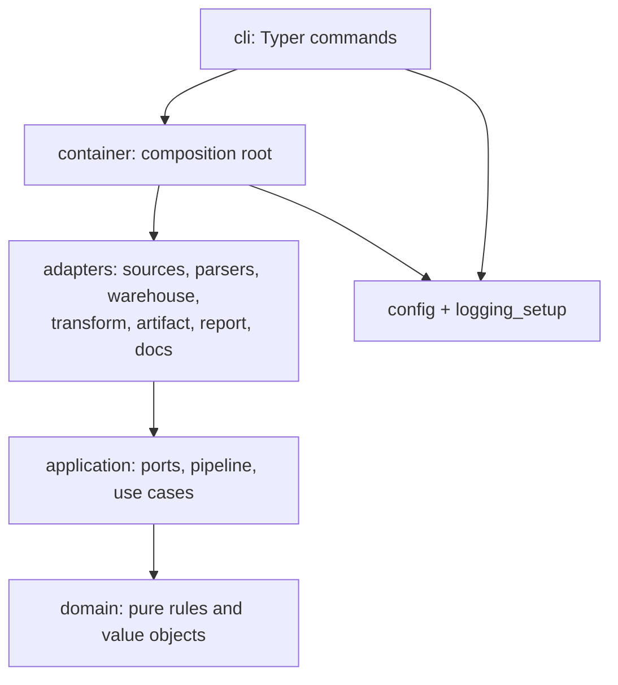
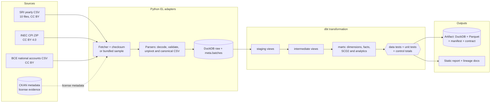
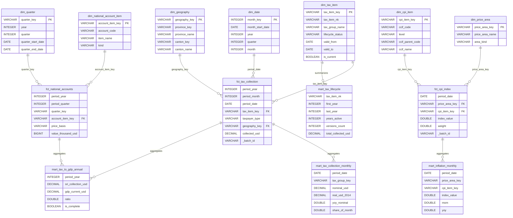
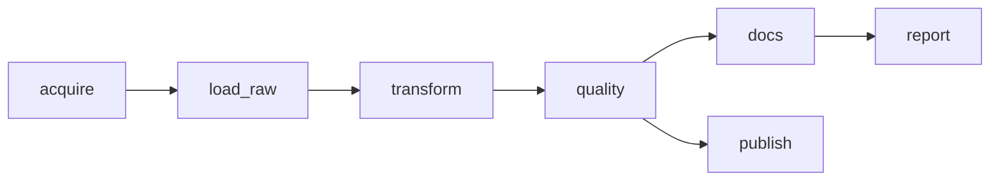

# Architecture

The Ecuador open-data lakehouse is a local-first analytics-engineering system:
one Python package installs a `lakehouse` CLI, one DuckDB file holds every
layer, and dbt owns the transformation layer. There is no server, no cloud
account and no mandatory network access: the default `sample` mode reads the
bundled data from the wheel, while `full` mode downloads the pinned upstream
files.

The design is hexagonal (ports and adapters). The pure domain is cheap to test,
the application layer orchestrates use cases through protocols, adapters own the
I/O, and a single composition root wires everything. Two independent mechanisms
enforce the dependency direction: import-linter contracts and an AST test that
scans every import under `domain/`.

## Layers

The dependency rule is:

Higher layers may import lower layers, never the other way around. `domain/`
imports only the Python standard library and `ecuador_lakehouse.domain`.
`application/` knows ports and domain value objects, may use the standard
library for file orchestration, and may not import `adapters/`, `config`,
`logging_setup`, `duckdb`, `dbt`, `httpx`, `jinja2`, `typer` or `rich`.
Adapter subpackages are mutually independent: a parser cannot import the
warehouse, the warehouse cannot import the report renderer.

| Package | Responsibility | Examples |
| --- | --- | --- |
| `domain/` | Pure rules, canonical text keys, DAG validation, batch and manifest value objects, error taxonomy | `domain/text.py`, `domain/dag.py`, `domain/manifest.py` |
| `application/` | Use cases and ports; pipeline orchestration; no concrete I/O | `application/ports.py`, `application/pipeline.py`, `application/use_cases/` |
| `adapters/` | Concrete I/O behind the ports | HTTP fetch, parsers, DuckDB, dbt, artifact, report, lineage |
| `cli/` | Typer commands, Rich presenters, exit-code guard | `cli/app.py`, `cli/commands/` |
| `container.py` | Explicit dependency wiring and strategy selection | `build_container()` |
| `config.py`, `logging_setup.py` | Cross-cutting settings and structlog configuration | `Settings`, `configure_logging()` |

Enforcement lives in `pyproject.toml` (`[[tool.importlinter.contracts]]`) and
`tests/architecture/test_layers.py`. The AST test also plants a violating file
in a temporary package so the guard cannot silently stop working.

## Ports and adapters

| Port (`application/ports.py`) | Adapter | Responsibility |
| --- | --- | --- |
| `SourceFetcher` | `HttpSourceFetcher`, `SampleSourceFetcher` | Acquire a pinned file and verify its SHA-256; strategy selected by mode |
| `LicenseCatalog` | `CkanCatalog` | Read CKAN license metadata |
| `SourceParser` | `SriTaxParser`, `BceCntParser`, `InecCpiParser` | Decode, validate and emit canonical UTF-8 CSV |
| `Warehouse` | `DuckDbWarehouse` | Raw-layer repository, batch ledger and one-transaction partition load |
| `RunLedger` | `DuckDbWarehouse` | Persist `meta.runs` pipeline records |
| `Transformer` | `DbtTransformer` | Seed, run and test dbt models in-process; parse and docs |
| `LineageRenderer` | `LineageMermaidRenderer` | Render the dbt DAG as Markdown/Mermaid |
| `ReportReader` | `DuckDbReportReader` | Read marts into a typed `ReportSnapshot` |
| `ReportRenderer` | `JinjaReportRenderer` | Write the static multi-page site |
| `ArtifactStore`, `ArtifactVerifier` | `DuckDbArtifactPublisher`, `DuckDbArtifactVerifier` | Publish and re-check the versioned data product |

The CLI and the composition root are the only places that know concrete
adapters. Swapping HTTP for the bundled sample changes one factory branch in
`container.py`, not the use cases.

## Patterns in use

The following patterns are deliberate, not decorative:

- **Ports & Adapters** — every external concern has a `typing.Protocol` port;
  adapters implement it and are chosen by the composition root.
- **Strategy** — `SourceFetcher` (HTTP vs bundled sample), `SourceParser`
  (SRI, BCE, INEC), decoding (UTF-8-sig then cp1252) and the pipeline step
  registry.
- **Factory / Composition root** — `container.build_container()` builds the
  object graph, selects the mode-specific fetcher and assembles the DAG steps.
- **Repository** — `meta.batches` is the append-only batch ledger behind
  `Warehouse.ledger()`, and `meta.runs` is the pipeline run ledger.
- **Unit of Work** — one partition load is a single DuckDB transaction: the
  previous partition rows, the ledger update and the new rows commit together
  or roll back together.
- **Pipeline / DAG with Template Method** — `domain.dag.Dag` validates and
  orders steps; `application.pipeline.PipelineRunner` supplies selection,
  retries, stop-on-failure and run recording, while each step supplies only its
  work through a common callable shape.
- **Value Objects** — frozen dataclasses such as `SourceFile`, `BatchRecord`,
  `QualitySummary`, `RunRecord` and `ArtifactManifest` validate at construction.
- **Specification-style generic tests** — `assert_between`,
  `assert_unique_combination`, `assert_scd2_integrity`,
  `assert_row_count_at_least` and `assert_no_month_gaps` encode data invariants
  reused across models.

## End-to-end data flow

Parsers preserve every source value as raw text in canonical CSV. dbt is the
only place where typing, decimal parsing, month parsing, key normalization,
surrogate keys and business models happen. This boundary is recorded in
[ADR 0003](adr/0003-el-in-python-t-in-dbt.md).

The raw layer keeps one table per source with all source columns as `VARCHAR`
plus `_batch_id`, `_source_file` and `_source_sha256`. The batch ledger records
the partition, source checksum, row count, status and whether the row is
current, so re-loading an identical partition is a no-op and a changed
partition is replaced inside a single transaction.

## dbt layering

The dbt project ships inside the wheel and is copied to the runtime home before
each run ([ADR 0001](adr/0001-stack-duckdb-dbt.md)). Naming follows
`stg_<source>__<entity>`, `int_*`, `dim_*`, `fct_*`, `mart_*`.

| Layer | Materialization | Models |
| --- | --- | --- |
| `staging` | view | `stg_sri__tax_collection`, `stg_bce__national_accounts`, `stg_inec__cpi_index` |
| `intermediate` | view | `int_tax_item_year_presence`, `int_tax_item_versions`, `int_tax_collection_monthly`, `int_cpi_national_monthly`, `int_gdp_annual` |
| `marts` | table / incremental | 7 dimensions, 3 facts and 4 analytic marts |

Every model and every column has a non-empty description; every mart has an
enforced contract. The committed [lineage document](LINEAGE.md) is generated
from a fresh `dbt parse` and a test fails if it drifts.

## Data model

The star schema has seven conformed dimensions, three facts and four analytic
marts. Surrogate keys are `md5` hashes of the natural-key parts, never
`row_number()`, so two builds agree.

| Table | Grain | Kind |
| --- | --- | --- |
| `dim_date` | month | dimension |
| `dim_quarter` | quarter | dimension |
| `dim_geography` | province x canton | dimension |
| `dim_tax_item` | tax natural key x SCD2 version | dimension (SCD2) |
| `dim_price_area` | INEC price area | dimension |
| `dim_cpi_item` | CCIF item | dimension |
| `dim_national_account_item` | BCE account item | dimension |
| `fct_tax_collection` | month x tax item version x taxpayer type x geography | incremental fact |
| `fct_cpi_index` | month x price area x CPI item | fact |
| `fct_national_accounts` | quarter x account item x price basis | fact |
| `mart_tax_collection_monthly` | month x tax group | analytic mart |
| `mart_inflation_monthly` | month x price area x CPI item level | analytic mart |
| `mart_tax_to_gdp_annual` | year | analytic mart |
| `mart_tax_lifecycle` | tax natural key | analytic mart |

`dim_tax_item` is a deterministic SCD2 SQL model, not a dbt snapshot: version
islands are derived from the presence matrix, validity comes from data rather
than wall-clock time, and facts join the version valid in their collection year
([ADR 0005](adr/0005-scd2-lifecycle-dimension.md)). `fct_tax_collection` is
incremental with `delete+insert` on `period_year`, so loading a changed current
year rewrites only that partition while older partitions keep their
`_batch_id`.

## Pipeline DAG

`lakehouse build` runs the default selection `acquire, load_raw, transform,
quality, docs, report`; adding `--publish` appends `publish`. The runner
supports `--select STEP` (the step plus its upstream), `--only STEP` (exactly
one step), `--from-step STEP` (the step and everything after it) and rejects
mutually exclusive combinations with exit code 2. Only `acquire` is retried,
because it is idempotent; every run, including a failed one, is written to
`meta.runs` with per-step status, attempts, duration and metrics.

The custom runner is a deliberate scope decision: Dagster and Airflow would add
a service and a metadata database to an L1, single-process CLI
([ADR 0006](adr/0006-custom-dag-runner-vs-dagster.md)).

## Failure model and exit codes

Every expected failure is a `LakehouseError` subclass that declares its exit
code. The CLI guard maps it to a clean message (no traceback unless `--debug`).
Unexpected exceptions exit 1.

| Exit code | Error | Meaning |
| --- | --- | --- |
| 0 | — | success |
| 1 | unexpected | unhandled exception (traceback only with `--debug`) |
| 2 | `ConfigError` | invalid configuration or command usage |
| 3 | `ChecksumMismatchError` | a pinned immutable download did not match its SHA-256 |
| 4 | `SourceSchemaError` / `UnsafeArchiveError` | upstream header drift or unsafe archive |
| 5 | `SourceUnavailableError` | a source cannot be reached or read |
| 6 | `TransformError` | dbt seed/run/parse/docs failure |
| 7 | `QualityGateError` | at least one dbt data or unit test failed |
| 8 | `ArtifactVerificationError` | artifact missing, corrupt or schema drift |

The pipeline stops at the first failing step, so a quality-gate failure never
reaches `docs`, `report` or `publish`.

## Idempotency, incremental loads and determinism

- **Acquisition** is idempotent: a cached file whose SHA-256 matches the pinned
  checksum is reused. Mutable files (the current SRI year) record an accepted
  vintage only with `--accept-new-vintage`; immutable mismatches fail with exit
  code 3.
- **Raw loading** is a Unit of Work: the warehouse compares the current ledger
  checksum for a partition, skips identical bytes, or deletes and reloads the
  partition in one transaction. A failure rolls back both data and ledger.
- **Incremental facts** use `delete+insert` on `period_year` with
  `on_schema_change: fail`, so contract drift stops the run instead of silently
  evolving a published table.
- **SCD2** is rebuilt from the presence matrix on every run, so the raw layer
  remains the single source of truth and re-running a build is safe.
- **Determinism** comes from data-only surrogate keys (`md5` of natural-key
  parts), no wall-clock columns in marts, stable ordering and `gzip mtime=0`
  for the bundled sample. Two fresh sample builds produce identical
  `content_sha256` values for all 14 published tables
  ([ADR 0007](adr/0007-artifact-contract-and-versioning.md)).

## CLI surface

| Command | Purpose |
| --- | --- |
| `lakehouse build` | Run the pipeline DAG; `--publish --out DIR` also publishes the artifact |
| `lakehouse test` | Run only the `quality` step (dbt data and unit tests) |
| `lakehouse fetch` | Download and verify pinned upstream files (`--source`, `--years`, `--accept-new-vintage`) |
| `lakehouse sample build` | Maintainer command that regenerates the bundled sample |
| `lakehouse docs` | Generate static dbt docs and Mermaid lineage (`--mermaid PATH`) |
| `lakehouse publish` | Publish the current marts as a versioned artifact (`--out`) |
| `lakehouse verify DIR` | Re-check a published artifact; exit 8 on tampering |
| `lakehouse contract check` | Compare the committed contract with the warehouse schema |
| `lakehouse serve` | Serve the generated report on loopback (`--host`, `--port`, `--open/--no-open`) |
| `lakehouse doctor` | Check versions, home writability, sample integrity and optionally network reachability |
| `lakehouse --version` | Print the package version |

## Configuration and observability

`config.Settings` is a `pydantic-settings` model with the `LAKEHOUSE_` prefix.
Invalid values become `ConfigError` (exit 2) before any work starts. Logging is
structlog with a `console` or `json` renderer, selected by
`LAKEHOUSE_LOG_FORMAT`. The complete variable list, defaults and CLI overrides
are in [CONFIGURATION.md](CONFIGURATION.md).

## Testing and quality gates

- `uv run python scripts/dev.py check` runs ruff lint, ruff format check, mypy
  strict, import-linter and the pytest suite (browser tests excluded).
- `uv run pytest -m e2e` runs the Playwright suite against a real generated
  site.
- dbt data tests, dbt unit tests and singular reconciliation tests run inside
  `lakehouse build`/`lakehouse test`; a failing test closes the gate with exit
  code 7.
- Coverage is enforced at 85 % branch coverage on `src/`, and a Hypothesis
  suite covers DAG ordering, text normalization, parser encoding parity, load
  permutations and SCD2 integrity.
- CI runs lint/types/architecture on Ubuntu and the test suite on Ubuntu,
  Windows and macOS, plus a browser job, an installer smoke matrix and security
  jobs.

The published data product and its versioning rules are documented in
[ARTIFACT.md](ARTIFACT.md) and [CONTRACT.md](CONTRACT.md); the source
provenance, measured facts and limitations are in [DATA.md](DATA.md).
